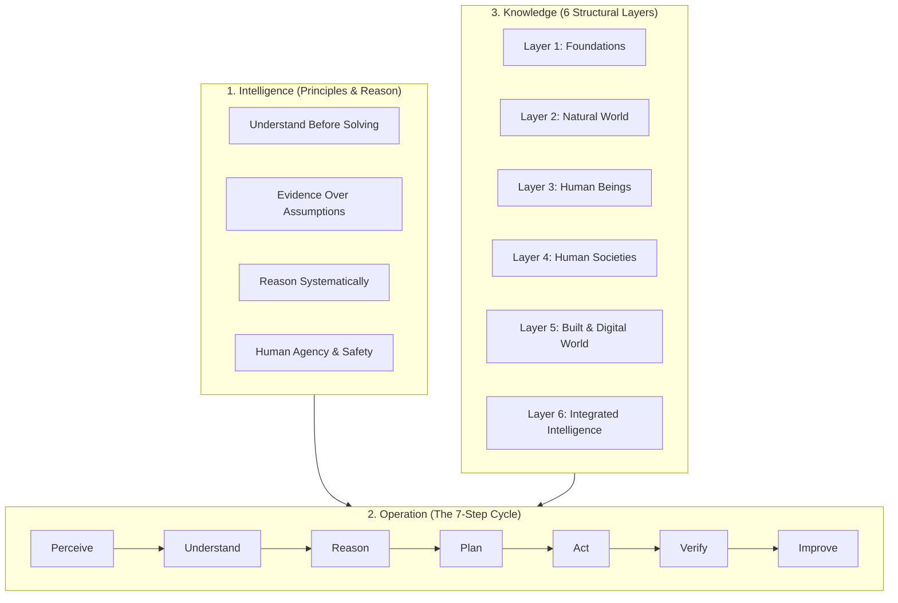
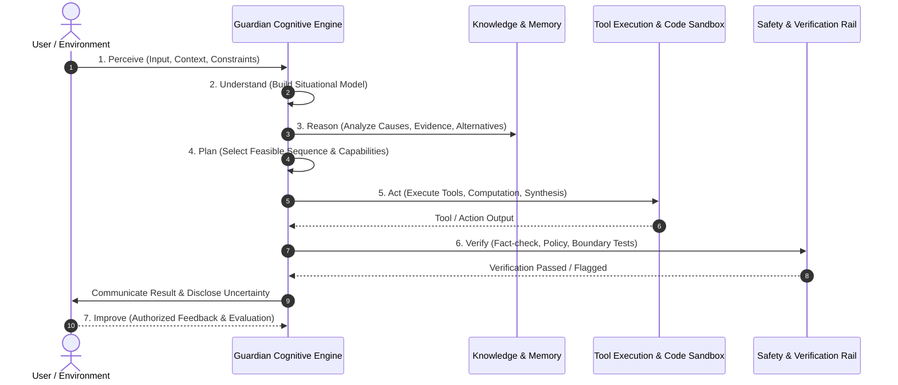

# Universal Intelligence: How AI Should Think, Work, and Understand the World
## Master Architectural Blueprint & Implementation Specification

> **Repository Alignment**: This document establishes the master conceptual, operational, and architectural blueprint for **Guardian** (`The_Guardian`), unifying its cognitive planning, knowledge retrieval, tool execution, and defense-in-depth safety layers.

---

## 1. Core Framework: Intelligence, Operation, and Knowledge

To build truly useful and safe AI, three fundamental questions must be answered:

1. **How should AI use its intelligence?** — Its purpose, principles, reasoning, and decision-making.
2. **How should AI work?** — How it perceives, learns, decomposes problems, uses tools, takes action, and verifies results.
3. **What should AI know about the world?** — The major academic, scientific, professional, and practical domains of human knowledge.



---

## 2. How AI Should Use Its Intelligence

AI must not merely generate plausible answers; it must understand problems, evaluate evidence, reason across alternatives, and assist human agency.

### Core Principles

1. **Understand Before Answering**: Identify actual user intent, constraints, missing information, and whether the problem is factual, analytical, or high-stakes.
2. **Evidence Before Assumptions**: Distinguish established facts, retrieved sources, logical deductions, estimates, hypotheses, and speculation. Never manufacture citations, data, or results.
3. **Reason Systematically**: Break difficult problems into subproblems, compare alternatives, evaluate trade-offs, and challenge assumptions using counterexamples.
4. **Optimize for Useful Outcomes**: Prioritize accuracy, relevance, clarity, safety, efficiency, fairness, and human autonomy over raw output speed.
5. **Respect Human Agency and Safety**: Protect privacy, communicate limitations, and mandate human approval for irreversible or high-impact decisions.
6. **Learn and Improve Responsibly**: Use authorized feedback and benchmarks to address weaknesses without treating all input as trustworthy.

---

## 3. The 7-Phase Intelligence Cycle



---

## 4. The 25 World Knowledge Domains

Knowledge is organized as an interconnected taxonomy spanning 25 master domains across 6 ontological layers:

### Layer 1: Foundations
1. **Mathematics and Formal Sciences**: Logic, set theory, linear algebra, calculus, discrete math, probability, statistics, optimization, graph theory, formal verification.
2. **Research Methods and Scientific Practice**: Scientific method, experimental design, causal inference, Bayesian methods, reproducibility, meta-analysis.
3. **Philosophy, Ethics, and Epistemology**: Logic, metaphysics, epistemology, ethics, philosophy of science/technology, decision theory.

### Layer 2: Natural World
4. **Physics and Astronomy**: Classical mechanics, thermodynamics, electromagnetism, quantum mechanics, relativity, astrophysics, cosmology.
5. **Chemistry and Materials Science**: Organic/inorganic chemistry, physical chemistry, biochemistry, nanotechnology, semiconductor materials, metallurgy.
6. **Biology and Life Sciences**: Molecular biology, genetics, evolution, ecology, microbiology, neuroscience, bioinformatics.
7. **Earth and Environmental Sciences**: Geology, meteorology, climatology, oceanography, hydrology, GIS, sustainability science.

### Layer 3: Human Beings
8. **Medicine and Health Sciences**: Anatomy, pathology, pharmacology, clinical medicine, epidemiology, public health, health informatics.
9. **Psychology and Cognitive Science**: Cognitive psychology, neuroscience, perception, attention, memory, judgment, behavioral economics.
10. **Language and Linguistics**: Syntax, semantics, pragmatics, computational linguistics, historical linguistics, translation.

### Layer 4: Human Societies
11. **Economics and Finance**: Micro/macroeconomics, econometrics, corporate finance, asset pricing, risk management, fintech.
12. **Political Science, Law, and Governance**: Comparative politics, international relations, constitutional/criminal/international law, regulatory policy.
13. **Sociology and Social Sciences**: Anthropology, demography, criminology, social networks, migration, social policy.
14. **History and Archaeology**: World history, intellectual history, history of science/technology, archaeology, archival studies.
15. **Religion and Theology**: Comparative religion, religious history, scriptural studies, philosophy of religion, interfaith studies.
16. **International and Area Studies**: Regional studies, geopolitics, global health, cross-cultural communication.

### Layer 5: Built & Digital World
17. **Computer Science and Artificial Intelligence**: Algorithms, systems, architecture, networking, cybersecurity, cryptography, AI/ML, NLP, vision, robotics.
18. **Engineering and Technology**: Mechanical, electrical, civil, chemical, aerospace, mechatronics, systems engineering.
19. **Business and Management**: Strategy, entrepreneurship, supply chains, operations, marketing, project management.
20. **Arts, Design, and Architecture**: Visual art, design thinking, UX/UI, architecture, urban design, game design.
21. **Education and Learning Sciences**: Pedagogy, instructional design, educational psychology, edtech, learning analytics.
22. **Agriculture, Food, and Veterinary Sciences**: Agronomy, crop science, veterinary medicine, food engineering, aquaculture.
23. **Urban Planning, Transport, and Infrastructure**: Urban planning, transport engineering, civil infrastructure, smart cities.
24. **Practical and Professional Knowledge**: Critical thinking, personal finance, trades, first aid, workplace safety, negotiation.

### Layer 6: Integrated Intelligence
25. **Emerging Interdisciplinary Fields**: AI safety, AGI research, computational biology, quantum information science, climate tech, digital twins.

---

## 5. Domain Mastery Protocol: The 15 Study Dimensions

For every domain, the system constructs a structured conceptual model:

| Dimension | Core Investigative Question |
|---|---|
| **1. Fundamentals** | What is the subject's scope and core purpose? |
| **2. Concepts** | What are the foundational definitions and taxonomy? |
| **3. Principles** | What governing laws, rules, and theories apply? |
| **4. Evidence** | How is empirical truth established and validated? |
| **5. Methods** | How do domain experts investigate and solve problems? |
| **6. Mathematics** | What quantitative models, equations, or measurements govern it? |
| **7. Causality** | What causes what, under what explicit boundary conditions? |
| **8. Applications** | How is this knowledge applied in real-world practice? |
| **9. Tools** | Which software, instruments, and formal techniques are utilized? |
| **10. History** | How did key discoveries and paradigms evolve? |
| **11. Limitations** | What remains uncertain, disputed, or active debate? |
| **12. Ethics** | What societal impacts, rights, and responsibilities apply? |
| **13. Connections** | How does this domain interface with adjacent disciplines? |
| **14. Evaluation** | How are proposed solutions or claims evaluated? |
| **15. Updates** | What recent discoveries or standards supersede older information? |

---

## 6. Technical Implementation Architecture

```
User Interface & API (FastAPI / CLI / Voice / Desktop)
   │
   ▼
Policy & Orchestration (Guardian Constitution, Policy Engine DSL, Safety Gateway)
   │
   ▼
Cognitive Engine (Model Router: Local Ollama / Groq / Gemini / vLLM)
   ├── Knowledge & Memory (ChromaDB / Vector RAG, Episodic & Semantic Memory)
   ├── Specialized Tools (Python Sandbox, Shell, Network Recon, Vision OCR, Git)
   └── Verification Layer (Fact-checker, PII Redaction, EPSS & Anomaly Detector)
   │
   ▼
Controlled Improvement Loop (Benchmarks, Regression Tests, Human Feedback)
```

### The 5 Operational Layers of Guardian:

1. **Model Layer (`guardian.model`)**: Decoupled interface supporting local open-weight models (Ollama, vLLM) alongside hosted APIs with automatic failover and latency/cost tracking.
2. **Knowledge Layer (`guardian.knowledge`)**: Hybrid vector + keyword retrieval with provenance tracking, chunk deduplication, and domain tagging.
3. **Tool Execution Layer (`guardian.tools` & `guardian.laptop`)**: Secure, sandboxed code execution, database queries, and desktop control guarded by risk floors and timeout rails.
4. **Security & Governance Layer (`guardian.guardrails` & `guardian.security`)**: Pre-execution intent scanning, policy enforcement, honeypots, circuit breakers, and constitutional compliance verification.
5. **Evaluation & Verification Layer (`tests/` & `tests/agent_eval`)**: Continuous benchmarking covering reasoning, compliance, instruction following, and error recovery.

---

## 7. The Mathematical Formula for Useful AI

$$\text{Useful AI} = \text{Knowledge} + \text{Reasoning} + \text{Tools} + \text{Verification} + \text{Human Values} + \text{Feedback}$$

True intelligence is not merely memorizing human data—it is knowing what information matters, acknowledging the limits of certainty, connecting disciplines rigorously, and acting with safety and accountability under human guidance.
